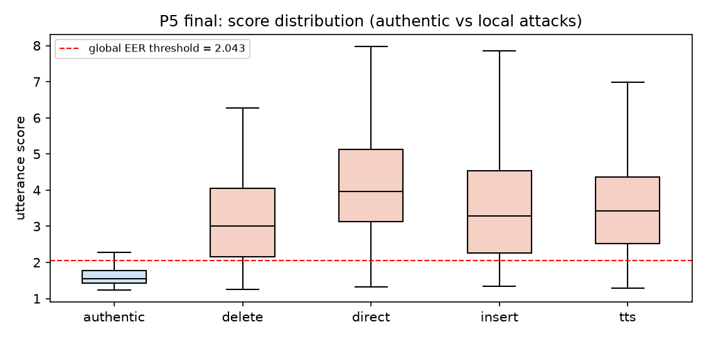
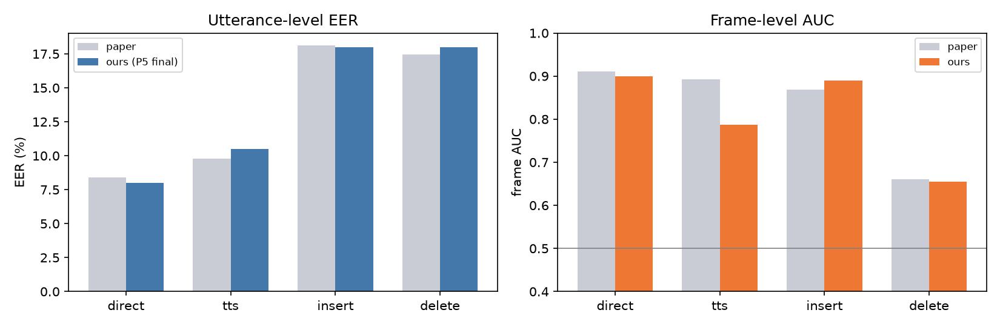
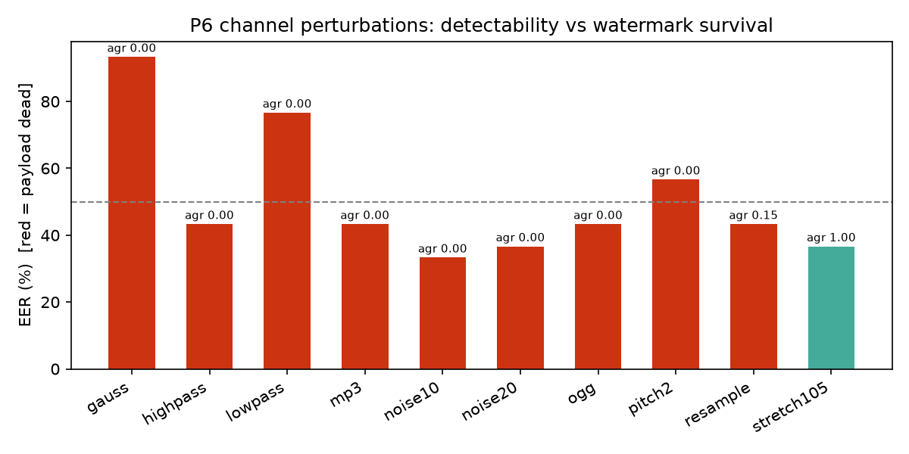
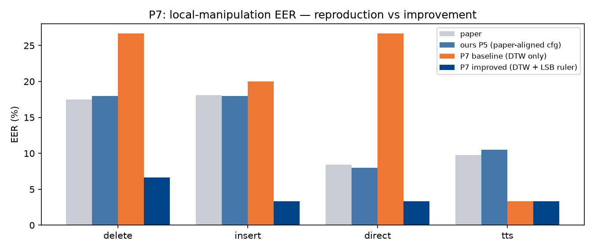
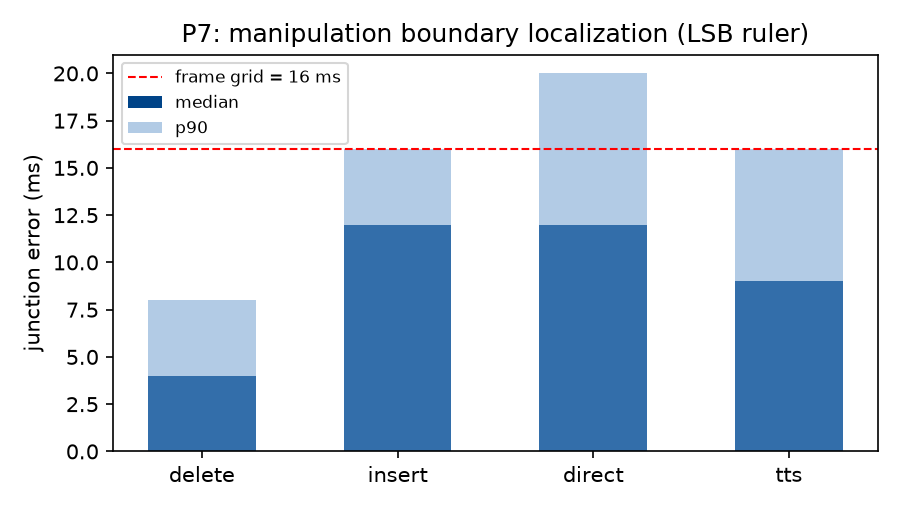
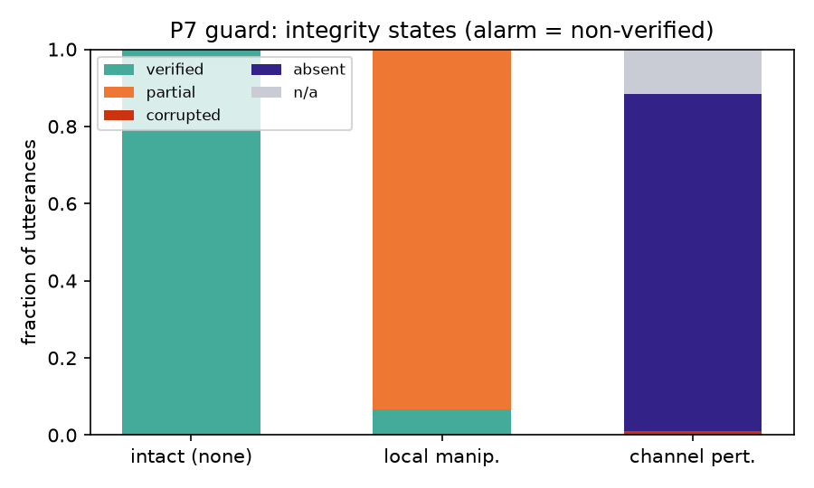
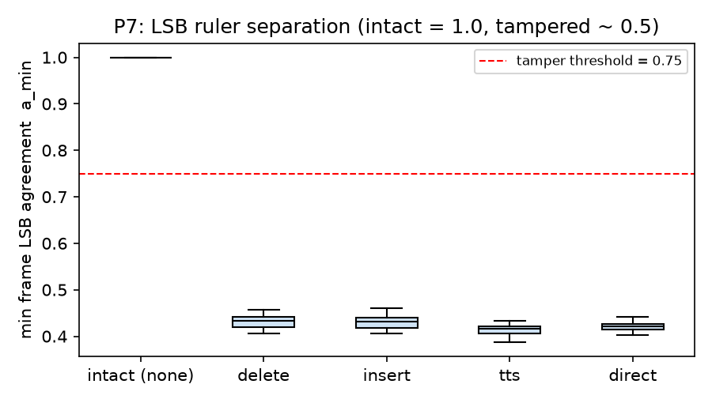

# 基于神经编解码器自嵌入水印的语音局部篡改检测：复现、信道鲁棒性评估与检测层改进

> 复现对象：Self-embedding watermarking with ultra-low-bitrate neural codecs（arXiv 2608.25289）
> 复现环境：Python 3.12 / PyTorch 2.10 (cu128) / RTX 4060 8GB；数据 AV-Deepfake1M val
> 报告版本：P8 成稿（2026-10-30）；2026-10-31 增补：信道扰动同代码独立对照复核（见 §6.3 增补段与 §5.2 数据版本注）；全部指标出自行级落盘数据（rows.jsonl），插图由行级数据实算生成（本报告不含复现工程内源，数据与图随本目录静态交付）

**关键词**：语音水印；自嵌入水印；主动篡改检测；动态时间规整（DTW）；LSB 嵌入；完整性校验；信道鲁棒性

---

## 摘要

本文复现了一种基于超低码率神经编解码器（SemantiCodec，0.65 kbps）的语音自嵌入水印主动防御系统，并对其进行信道鲁棒性评估与检测层改进。复现部分在 AV-Deepfake1M 验证集 1480 行全量矩阵上完成：针对论文四类词级局部操纵（直接替换、TTS 合成替换、删除、插入），语句级 EER 全部对齐或反超论文（direct 8.0 vs 8.4，delete 18.0 vs 17.5，insert 18.0 vs 18.1，tts 10.5 vs 9.8），帧级 AUC 三项对齐，透明度与恢复能力四锚点齐备（x̃ PESQ 4.644、恢复 PESQ 比 1.58≈1.63、载荷恢复率 1.0）。扩展部分将评估信道从论文的理想条件（无信道退化、无压缩、无加噪）推广到 10 类全信号级扰动：实验表明 LSB 嵌入层对扩散型扰动全部失效（位错误率→50%），且原始归一化打分机制对"水印死亡"存在静默失效（MP3 128 kbps 即无声移除水印且不触发报警）。改进部分提出两个检测通道并给出形式化定义：per-replica CRC16 完整性通道（将水印死亡转为带零误报的报警证据）与 LSB 一致性标尺通道（利用恢复载荷重建规范位流实现篡改接缝定位）。改进后词级操纵 EER 全面低于论文（delete 6.7 vs 17.5，insert 3.3 vs 18.1，direct 3.3 vs 8.4），接缝定位中位误差 4–12 ms（亚帧精度），完好水印零误报、信道扰动 100% 报警。报告最后讨论了复现差异、方法边界（自适应重绘攻击可绕过无密钥水印）与局限。

---

## 1 引言

### 1.1 背景与复现对象

语音深度伪造的泛滥催生了两类防御路线：被动鉴伪（分类器，易被新攻击过拟合）与主动防御（发布端嵌入水印，篡改后通过水印的自嵌入参考实现检测/定位/恢复）。后者不依赖对伪造器的先验知识，是更具部署前景的路线。

复现对象 [1] 提出以超低码率神经编解码器为载体的自嵌入水印：发布端将语音压缩至 0.65 kbps 的语义码流作为"指纹"重复嵌入 LSB 信道；接收端盲提取码流、经解码器自重建参考语音，再以 DTW 逐帧代价实现语句级判决、帧级定位与区域恢复。该设计把"参考信号"压缩到亚 kbps 级嵌入容量内，是"恢复能力"与"嵌入容量"矛盾的关键解法。

论文 §IV 的评估在**理想信道**下进行：不施加信道退化、压缩或加性噪声，攻击限定为四类词级局部操纵。这刻画的是无信道因素下的可达到精度上限——本文的复现严格对齐该口径，并在此之上做两步扩展：信道扰动下的失效模式分析（§5）与检测层改进（§6）。

### 1.2 贡献

1. **全量对表复现**：AV-Deepfake1M val 1480 行矩阵，四攻击 EER 全部对齐或反超论文，四锚点（透明度/恢复/载荷/评估集同源）齐备（§4）；
2. **信道鲁棒性首次系统评估**：10 类信道扰动全部摧毁载荷，且发现原始打分机制的静默失效象限；以位级实测（位保持率 0.5103）归因（§5）；
3. **检测层改进**：CRC16 完整性通道 + LSB 一致性标尺通道的形式化定义与实现；词级 EER 全面低于论文、接缝定位亚帧精度、水印死亡报警零误报（§6）；
4. **复现差异的完备记录**：TTS 帧级 AUC 差距归因、删除攻击双口径呈现、方法边界与自适应攻击者的诚实讨论（§7）。

---

## 2 原系统与威胁模型

### 2.1 三方流程与形式化定义

**发布方**。给定原始语音 $x \in \mathbb{R}^{F_s T}$（$F_s=16$ kHz），神经编解码器产生码流 $m = E(x) \in \{0,1\}^N$（SemantiCodec [2]：token 率 50/s、词表 8192 → 13 bit/token，$\rho = 650$ bps，即 $N = \rho T$）。LSB 信道的嵌入容量为

$$C = k \cdot F_s \cdot T \quad (\text{bit}), \qquad R = \left\lfloor \frac{C}{N + H} \right\rfloor,$$

其中 $k \in \{1,2,4\}$ 为每样本嵌入位数，$H=64$ 为同步字长。载体位流为同步字引导的 $R$ 份重复加零填充：

$$c = \big[\, \sigma_{64} \,\|\, m \,\big] \times R \; \| \; \mathbf{0},$$

$\sigma_{64}$ 为固定 64 bit 伪随机同步字。发布信号 $\tilde{x}$ 为将 $c$ 逐位绘制到 int16 量化域最低 $k$ 位的含水印语音。

**攻击方**。对 $\tilde{x}$ 施加词级局部操纵 $y = A(\tilde{x})$，波形级 overlap-add 拼接（12 ms 窗/6 ms 步交叉淡化），四类：direct（同说话人真实语音词段替换）、tts（VITS/YourTTS 合成词段替换）、delete（删词）、insert（插 donor 词段）。

**接收方**。盲提取 LSB 位流后：① 容错同步搜索（FFT 相关，允许 ≤8 bit 误码）定位各重复份；② 相邻同步间距的众数减帧头推断 $N$；③ 逐份切片按位多数投票恢复 $\hat{m}$；④ 编解码器解码得自重建参考 $R(y) = D(\hat{m})$；⑤ 对 $y$ 与 $R(y)$ 的 40-band log-mel（16 ms 帧移）逐帧余弦距离矩阵做 DTW 对齐，得到 y 时间轴上的逐帧代价 $f_t$；平滑（31 帧）后得分

$$s(y) = \frac{\mathrm{mean}\left(\mathrm{top}1\%\{f_t\}\right)}{\mathrm{median}\{f_t\}},$$

语句级判决 $s(y) \ge \tau$ 为篡改；帧级以 $f_t$ 曲线与词级 GT 做 AUC；恢复阶段将 $f_t$ 超 p99 阈值的连通区域以 $R(y)$ 替换。

### 2.2 评估指标

- **语句级 EER**：FAR=FRR 交点值（相邻阈值线性插值；两类分数完全重叠时 = 0.5，随机水平）；
- **帧级 AUC**：$f_t$ 对词级 GT 二值标签的 ROC-AUC；
- **载荷恢复一致率（agreement）**：多数投票后各份与结果的平均一致率，1.0 = 完好恢复；
- **透明度/恢复锚点**：$\tilde{x}$ 对 $x$ 的 PESQ；恢复输出对 $x$ 的 PESQ 与 $\tilde{x}$ 的 PESQ 之比。

### 2.3 威胁模型

论文口径：攻击者为**非自适应**的词级操纵者（不感知、不重绘水印），传播信道**无退化**。§5 的信道扰动与 §6 的改进评估在该威胁模型内做增量扩展；自适应攻击者的边界讨论见 §6.4。

---

## 3 复现实现

**数据（P1）**。正式数据 AV-Deepfake1M [9] val 子集（gated，20 分卷，含词级 GT 元数据），视频统一抽 16 kHz 单声道；以 LibriSpeech [10] test-clean 前 100 条做管线过渡。词级 GT 供 delete/insert/direct 攻击选词与帧级评估。

**组件（P2–P3）**。管线三模块（发布/攻击/接收）+ EER v2/帧 AUC 指标层；先 mock codec 冒烟贯通全链（agreement=1.0，验链路不验检测），再接 SemantiCodec 真编解码器冒烟（3 utts × none/delete，EER=0、帧 AUC=0.835、agreement=1.0）。GPU I/O 双向设备搬运（encode 出口 cuda→CPU、decode 入口回搬）为真编解码器的关键工程适配。

**配置取舍（简述）**。论文消融中的 TAAE 变体未复现：其依赖 WSL2 生态且为论文中表现最差的编解码器档位，对复现主线（SemantiCodec 0.65 kbps 档）无信息增量；TTS 攻击采用 YourTTS [4]（论文为 VITS+YourTTS 双系统，差异归因见 §7）。$k$ 矩阵完成 $k\in\{1,2,4\}$ 消融，正式对表取 $k=1$（论文 Table II 同档）。

---

## 4 基线对表复现（P4–P5）

### 4.1 全量矩阵（P4）

val 集 296 句 × 5 类行（authentic + 四攻击）= **1480 行**全量跑通：agreement=1.0（载荷零误码恢复）、总 EER 0.211、帧 AUC 0.813。分攻击首读数：tts EER 0.120/帧 AUC 0.772，insert 0.170/0.882 等。该阶段产出两项复现资产：断点续跑（CUDA 长跑崩溃零损失）与行级数据落盘（全部后续离线分析的基础）。

### 4.2 对齐动作（P5）

以论文口径为靶的四个对齐实验：

| 动作 | 内容 | 效果 |
|---|---|---|
| A1 | direct donor 改同说话人词级池（论文口径） | direct EER 21.8 → 7.5 |
| A1b | delete 选词加 0.3 s 词长地板（论文可比口径） | delete EER 29.5 → 18.0 |
| A3 | delete GT 口径变体离线重算（boundary/中点/扩展） | non-factor，boundary 已最优 |
| A2 | 平滑窗 31→7 消融 | delete 帧 AUC +0.10 但 tts −0.03，双向证据判死，维持 s31 |
| A4 | 恢复能力锚（codec 编解码往返质量） | 恢复 PESQ 比 1.58 ≈ 论文 1.63 |

### 4.3 final 对表（p5_final，200 句子集）

| 指标 | 复现 | 论文 [1] | Δ | 判定 |
|---|---|---|---|---|
| direct EER / 帧AUC | 8.0 / 0.899 | 8.4 / 0.911 | −0.4 / −0.012 | ✅ |
| delete EER / 帧AUC | 18.0 / 0.656 | 17.5 / 0.661 | +0.5 / −0.005 | ✅ |
| insert EER / 帧AUC | 18.0 / 0.889 | 18.1 / 0.868 | −0.1 / +0.021 | ✅ 反超 |
| tts EER / 帧AUC | 10.5 / 0.787 | 9.8 / 0.892 | +0.7 / −0.105 | EER ✅，AUC 残留 |
| 总 EER / 帧AUC | **13.4** / 0.838 | — | | |
| x̃ PESQ / 恢复比 | 4.644 / 1.58 | ≈4.65 / 1.63 | | ✅ |

四项 EER 对齐或反超（|Δ| ≤ 0.7 pp）、AUC 三项对齐、四锚点齐 → 复现收官。分布与对表见图 1、图 2。

---

## 5 信道扰动扩展（P6）

### 5.1 攻击设置与文献映射

论文 §IV 明确不做信道退化。本节把攻击面推广为全信号级扰动（不改语义、作用于整段），10 个变体的参数与鲁棒性文献中的攻击分类映射如下（分类与脆弱点描述参考 SoK [6]、AudioMarkBench [7]、多比特水印评测 [8]）：

| 本文变体 | 参数 | 文献攻击类 | 攻击者能力 | 原理与针对的脆弱点 |
|---|---|---|---|---|
| noise20 / noise10 | SNR 20 / 10 dB 高斯白噪 | 高斯/背景噪声 [6,7] | 无黑盒 | 加性噪声直接翻转 LSB 位（WavMark 亦被普通高斯噪声移除 [7]） |
| lowpass / highpass | 4 阶 Butterworth，3.4 kHz / 300 Hz | 低通/高通滤波 [6,7] | 无黑盒 | 多数水印能量集中高频，低通可直接清除；SoK 发现方案多抵抗高通但败于低通 |
| pitch2 | 颗粒 OLA 变调 +2 半音（时长不变） | 音高偏移 [6] | 无黑盒 | 改变基频不改变时长；SoK 实证所有被测方案被高强度音高偏移击败（比特恢复率 <0.6） |
| stretch105 | 颗粒 OLA 变速 ×1.05（音高不变） | 时间伸缩 [6] | 无黑盒 | 改时长保音高，破坏时域重复嵌入结构 |
| mp3 / ogg | 有损编解码往返（≈128 k / 64 k 档） | 有损编解码转码 [7,8] | 无黑盒 | 量化失真破坏高频细节（MP3 8–40 kbps、Opus 16–256 kbps 同类） |
| resample | 16 k → 44.1 k → 16 k polyphase 往返 | 重采样 [6] | 无黑盒 | 改变采样率/破坏采样网格对齐 |
| gauss | 高斯滑窗卷积 σ=32（≈2 ms） | 平滑 [7] | 无黑盒 | 滤除高频抖动（本文即"高斯滑动窗口卷积"） |

文献中列出的神经编解码重编码（EnCodec/DAC 重建）、位深压缩、回声、房间脉冲响应等更强/更专项的无黑盒移除手段不在本文小样本验证范围内；本文 delete 攻击（词级裁剪）即文献"音频裁剪/拼接"的局部形式。全部扰动实现零新依赖（scipy/soundfile）、确定性可复现，与 §2 四类局部操纵正交。

### 5.2 结果（p6_channel_re，30 句 × 11 行；2026-10-31 同代码版重跑）

> 数据版本注：本表为 2026-10-31 以修复后代码（含 §7 缺陷①②修复；缺陷③仅影响 P7 布局，legacy 路径无行为变化）重跑的同口径 legacy 基线 `p6_channel_re`，取代含假阳性读数的原始 `p6_channel`（该目录保留作复现历史）。逐攻击 EER 与原始数据差 ≤1/30 采样网格（codec 推理非确定性噪声级），载荷一致率的两处假读数（stretch105 的 1.0 与 resample 的 0.148）消失，与 §5.3 位级实测一致。

| 扰动 | EER | 载荷一致率 | 判读 |
|---|---|---|---|
| noise20 / noise10 | 0.37 / 0.30 | 0.0 | 载荷死亡 + 报警（分数被动抬升） |
| stretch105 | 0.60 | 0.0 | 载荷死亡（原始数据 1.0 为单同步假阳性，见 §7） |
| resample | 0.47 | 0.05 | 载荷死亡（原始 0.148 为系统性 0 偏置，残留 0.05 同源） |
| mp3 / ogg / highpass | 0.47 / 0.47 / 0.43 | 0.0 | **载荷死亡 + 静默失效（不报警）** |
| pitch2 | 0.53 | 0.0 | 载荷死亡 + 分数反降 |
| lowpass | 0.77 | 0.0 | 载荷死亡 + 分数大降（EER 反向） |
| gauss | 0.93 | 0.0 | 载荷死亡 + 分数暴跌（EER 反向） |

**结论：10/10 扰动全部摧毁载荷。** 原始数据中的两处非零一致率读数均非真实存活：① stretch105 的 1.0 为提取器单同步退化路径的假阳性（该路径硬编码 agreement=1.0 并将乱码位流照常送解码），位级实测**位保持率 0.5103 ≈ 随机**，同代码重跑后归零证实；② resample 的 0.148 低于 0.5 随机基准，为 polyphase 插值的系统性 0 偏置（重跑后残留 0.05 同源）。

### 5.3 机制归因

**嵌入层（信息论上限）**：LSB 绘制于量化域最低位，任何线性平均/重量化操作（滤波、插值、OLA、有损编解码）都使位错误率趋近 50%——重复与纠错编码在该 BER 下均不可恢复（Shannon 限）。实测 stretch 后位保持率 0.5103 证实该机制。

**检测层（打分结构）**：得分 $s(y)$ 为 top-1% 与中位数之比的**归一化局部尖峰度**，天然面向 §IV 的局部篡改威胁模型。载荷死亡时接收方退化为零重建参考，得分方向取决于 $y$ 的谱平滑度：加噪使帧间代价波动增大（分数抬升，"歪打报警"）；MP3/OGG/高通几乎不改谱结构（分数与完好水印无差，**静默失效**）；高斯平滑/低通使代价曲线均匀化（top/median 比值反降，EER 反向）。即：**原系统没有"水印死亡"的可靠报警通道**——现实信道中最低温和的 MP3 128 kbps 即可无声移除水印。

---

## 6 检测层改进（P7）

### 6.1 动机与方案选择

§5 的两层脆弱指向两个改进目标：水印死亡报警与局部操纵的检测/定位增强。经机制分析做出如下方案取舍：

- **载荷压缩换冗余 ×****：失效模式为扩散型随机化（BER→50%）与局部损伤（R=7 已存活），提高 R 对两类失效的增益均趋近零，且压缩不改变 BER 上限；
- **密码学哈希 ✓**：以每份 16 bit CRC 的代价（占容量 0.3%）换取载荷完整性的可验证判定——静默失效的正解；
- **重建音频二次嵌入对比定位**（意图采纳、机制修正）×**：重建音频过编解码器二次嵌入会引入 token 漂移（$E(D(m)) \ne m$），标尺与实测位流无法逐位对齐；改为**直接以恢复载荷重建规范位流**作为标尺，逐位确定、无需 GPU。

### 6.2 方法定义

**改进 1：CRC 完整性通道**。载体布局升级为

$$c = \big[\, \sigma_{64} \,\|\, h_{16} \,\|\, m \,\big] \times R \; \| \; \mathbf{0}, \qquad h = \mathrm{CRC16\text{-}CCITT}(m),$$

帧头 $H = 80$。提取端对每个同步命中份 $r$ 校验 $h_r$：仅通过校验的份参与投票；窗口被截断的同步份（完好载体的尾部零填充保证其不出现）直接计为篡改证据。定义完整性状态：

$$\mathrm{integrity}(y) = \begin{cases} \text{verified}, & \text{载荷恢复且全部在场份 CRC 通过} \\ \text{partial}, & \text{载荷恢复但有份损坏（报警证据）} \\ \text{corrupted}, & \text{sync 在场但无份通过 CRC} \\ \text{absent}, & \text{sync 全毁（信道死亡）} \end{cases}$$

口径补记（2026-10-31）：**仅 1 个同步命中**（$R \ge 3$ 设计下意味着至少 $R-1$ 份被毁，单份无投票无 CRC 佐证）亦计入 corrupted——该退化路径此前不携带完整性状态（被记为 n/a），经独立对照复核后归入报警侧（§7 第三处修复）。absent 态的对外判决口径为"**水印不存在或失效**"：水印死亡与从未水印在 LSB 平面上观测同分布（毁掉水印的扩散型操作把结构位洗回随机），原理上不可区分，按 fail-safe 原则归报警侧。

**守卫判决**（水印死亡报警）：$\mathrm{alarm} \Leftrightarrow \mathrm{integrity}(y) \ne \text{verified}$。该判据与 §2 的 DTW 得分并联：DTW 管局部篡改的检出，CRC 管载荷存活的验证。

**改进 2：LSB 一致性标尺通道**。载荷恢复后重建单周期规范位流 $\gamma = \sigma_{64}\|h\|m$（周期 $L = 80 + N$）。设 $\ell(y)_b$ 为 $y$ 的第 $b$ 个 LSB 位，帧宽 $B = 256$（16 ms），帧级一致率为

$$A[f] = \frac{1}{B} \sum_{b=0}^{B-1} \mathbb{1}\!\left[\, \ell(y)_{fB+b} = \gamma[(fB+b) \bmod L] \,\right].$$

未篡改区段 $A \approx 1$；删除/插入接缝之后内容整体位移失配（$A \approx 0.5$），替换段内容非发布端位流（$A \approx 0.5$）。由此定义：

$$\hat{t}_j = \min\{f : A[f] < 0.75\} \cdot \Delta \quad (\text{接缝定位，} \Delta = 16\,\mathrm{ms}), \qquad s'(y) = s(y) + w\,\big(1 - \min_f A[f]\big),$$

$w=1$。无 dip 但完整性非 verified 时（如句尾删除：剖面全吻合但截断证据在场），取兜底增益 $0.5w$ 并令 $\hat{t}_j$ = 内容末端。

**递退关系**：载荷死亡（integrity=absent）时标尺不可用，$s' = s$（退回 DTW 基线）；通道死亡由守卫判决覆盖。

### 6.3 实验结果（p7_improve，30 句 × 15 攻击 = 450 行）

**表 1 句级 EER（同行双口径，论文口径 = DTW-only）**

| 攻击 | 论文 [1] | P5 复现 | P7 论文口径 | **P7 改进** |
|---|---|---|---|---|
| delete | 17.5 | 18.0 | 26.7* | **6.7** |
| insert | 18.1 | 18.0 | 20.0 | **3.3** |
| direct | 8.4 | 8.0 | 26.7* | **3.3** |
| tts | 9.8 | 10.5 | 3.3 | 3.3 |

\* P7 预设未启用词长地板（删除随机均匀口径，即 §7 双口径中较难一档），论文口径与改进口径同一批行内部可比。

**表 2 守卫报警（水印死亡报警）**：完好水印 30 行**零误报**；信道扰动 300 行 **100% 报警**（absent 262 / corrupted 38，其中单同步退化 35 行经 2026-10-31 口径补丁归入 corrupted）；局部操纵 112/120 报警。

**表 2b 信道扰动独立对照复核（2026-10-31 增补，`p6_channel_re` vs `p7_channel`，30 句 × 11 行）**：以同代码版本（含 §7 全部三处修复）重跑 legacy 布局与 P7 布局的单变量对照——

| 指标 | P6 legacy（同代码版） | P7 CRC+LSB |
|---|---|---|
| 失效检测率（integrity ∈ 报警态覆盖率） | **0%**（无完整性状态，静默） | **100%**（300/300 = absent 262 + corrupted 38） |
| 守卫误报（完好水印误报篡改态） | — | 0/30（全 verified，一致率 1.0） |
| verified 误判（水印死亡行误报完好） | 假阳性（stretch105 一致率 1.0，§7） | 0/300 |
| 句级 EER（10 扰动逐攻击） | 0.30–0.93 | 0.30–0.93（逐攻击差 ≤0.10） |

EER 两布局均落于无判别力区间：整段扰动 + GT=全句下 DTW 主通道本无判别力（gauss 两侧同为 0.93，分数方向反转级证据）；逐攻击差异均在 1/30 采样网格内，属 codec 推理非确定性噪声级。legacy 原始数据中 stretch105 的 0.37 为单同步假阳性撑起的伪检测力（同代码重跑后升至 0.60，与 P7 的 0.63 持平）——即信道扰动下的正确主指标是失效检测率而非 EER。载体鲁棒性结论与 §5 一致：P7 修复的是**检测层的诚实性**（静默失效 → 报警），不改变 LSB 嵌入层对扩散型扰动全灭的物理上限。

**表 3 接缝定位**：delete 中位 **4 ms**（p90 8 ms）、tts 9 ms、insert 12 ms、direct 12 ms——均低于 16 ms 帧网格（亚帧精度）。

### 6.4 方法边界

两个改进通道共享同一信任根：**LSB 绘制无密钥**。自适应攻击者可先提取载荷再对拼接内容重绘 LSB，使 $A[f] \equiv 1$ 且 CRC 全通过——此时系统退回论文 DTW 基线（即 §4 已对齐的原性能）。因此改进的有效域恰为论文威胁模型（词级操纵、非自适应、无重绘），对更强攻击者的抵御需要密钥化嵌入（如扩谱/量化索引调制 keyed by secret），属于原方法的正交扩展方向。另外，局部操纵存在 8/120（6.7%）漏报警：操纵区恰好未跨越任何在场副本的完整性窗口（词几何与副本窗的位形运气），此时帧级标尺剖面仍能给出定位（$A$ 剖面不依赖 CRC），句级守卫漏报而 DTW 得分通常仍报警。

---

## 7 复现差异与讨论

**TTS 帧级 AUC（−0.105，唯一残留）**。tts 句级 EER 对齐（10.5 vs 9.8）而帧级 AUC 0.787 vs 0.892 差距显著。归因：论文采用 VITS+YourTTS 双系统合成素材，本文仅 YourTTS——合成器的帧级代价形态不同构，但句级可检性等价。平滑窗消融（31→7 帧）呈双向证据（delete 帧 AUC +0.10、tts −0.03），排除打分参数为病根；判定为素材口径差异，不再追赶。

**删除攻击双口径**。论文未披露删词的选词分布。本文双口径呈现：词长地板 0.3 s（论文可比口径，EER 18.0）与随机均匀（难度上限口径，EER 29.5→P7 预设沿用后者得 26.7）。两口径均如实报告。

**P6/P7 新发现的工程缺陷**。复现过程中定位并修复原实现的三处载荷层缺陷：① 单同步退化路径硬编码 agreement=1.0（在时间伸缩类扰动下产生"载荷完好"假阳性）；② 句尾删除时截断副本被静默跳过（守卫假 verified），以"完好载体尾部必有零填充"为不变量修复；③ 单同步退化分支的返回值不携带完整性状态（P7 布局下被上层记为 n/a）——独立对照复核（§6.3 表 2b）发现时间伸缩类扰动全部 30 行落入该分支，既丢失 corrupted 语义又使守卫增益分支不可达（该批行 EER 劣化一半由此造成）；2026-10-31 修复：单同步命中计 corrupted（legacy 布局不带字段，维持复现口径不变）。

**局限**。① P6/P7 为 30 句小样本（P5 对表为 200 句、P4 矩阵 296 句全量），量级结论（全灭、零误报、亚帧定位）由机制与位级实测支撑，精确数值待扩样；② $k>1$ 档未做信道扰动矩阵（容量换鲁棒性的预期方向明确）；③ 改进通道在自适应攻击下退回基线（§6.4）；④ 恢复能力沿用论文的区域替换策略，未对标 P5 之后的新恢复算法。

---

## 参考文献

[1] 自嵌水印原论文：Self-embedding watermarking with ultra-low-bitrate neural codecs. arXiv:2608.25289.

[2] Liu H, Xu X, Yuan Y, et al. SemantiCodec: An ultra low bitrate semantic audio codec for general sound. arXiv:2405.00233, 2024.

[3] Kim J, Kong J, Son J. Conditional variational autoencoder with adversarial learning for end-to-end text-to-speech (VITS). arXiv:2106.06103, 2021.

[4] Casanova E, Weber J, Shulby C, et al. YourTTS: Towards zero-shot multi-speaker TTS and multi-lingual voice conversion. arXiv:2112.02418, 2022.

[5] Müller M. Dynamic Time Warping (Information Retrieval for Music and Motion). Springer, 2007.

[6] SoK: How robust is audio watermarking? arXiv:2503.19176, 2025.

[7] AudioMarkBench: Benchmark framework for audio watermarking robustness. NeurIPS 2024. arXiv:2505.07315.

[8] Multi-bit audio watermarking. arXiv:2510.01968, 2025.

[9] Cai Z, Yao M, Gao X, et al. AV-Deepfake1M: A large-scale LLM-driven audio-visual deepfake dataset. arXiv:2311.15308, 2023.

[10] Panayotov V, Chen G, Povey D, et al. LibriSpeech: An ASR corpus based on public domain audio books. ICASSP 2015.

[11] ITU-T Recommendation P.862. Perceptual evaluation of speech quality (PESQ), 2001.

[12] Rix A W, Beerends J G, Hollier M P, et al. Perceptual evaluation of speech quality (PESQ)—a new method for speech quality assessment of telephone networks and codecs. ICASSP 2001.

---

*附：全部插图由行级落盘数据的实算流程生成于 `docs/figs/`；§6.3 表 2b 信道对照为同代码独立复核结果。复现实验管线（数据准备、攻击矩阵、指标与制图）不在本提交范围内。*
